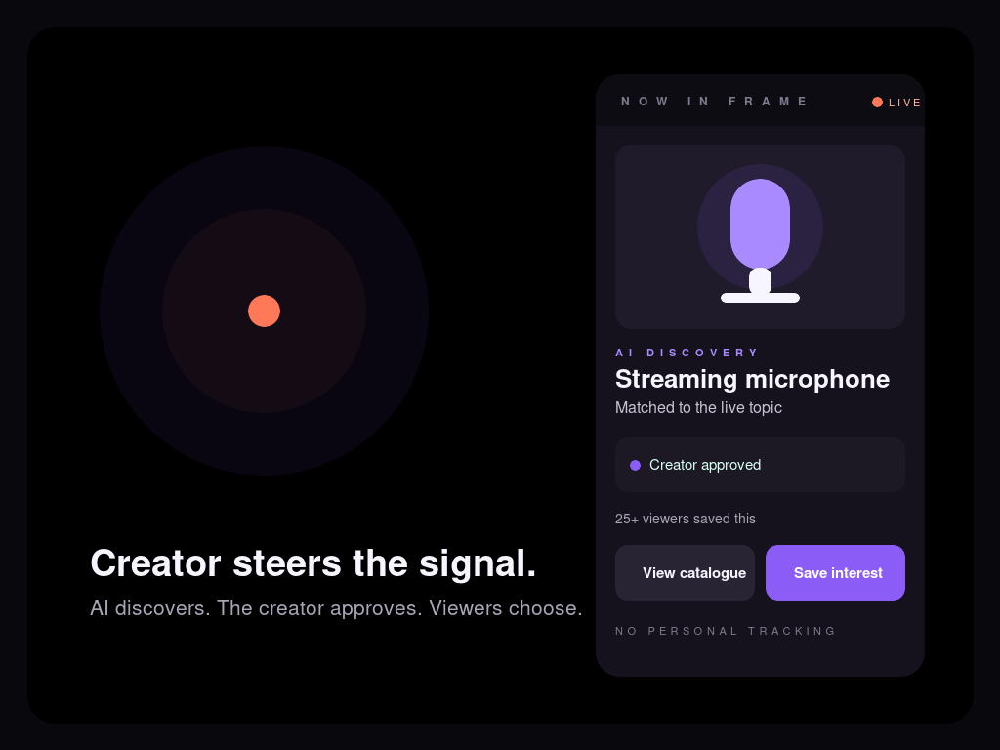
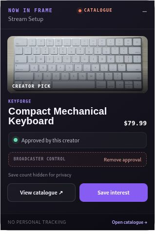
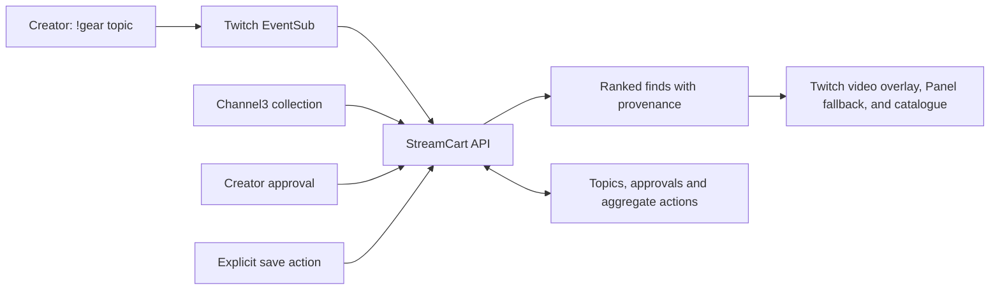

# StreamCart



[](https://github.com/Protocol-X-01/StreamCart/actions/workflows/ci.yml)

**[Try the live walkthrough](https://streamcart-twitchcon-site-20261102.onrender.com/extension/index.html?channel=demo)** · **[Explore the collection](https://streamcart-twitchcon-site-20261102.onrender.com/catalogue/?channel=demo)** · **[View the build evidence](https://streamcart-twitchcon-site-20261102.onrender.com/proof/)**

Creator-controlled, AI-assisted product discovery over Twitch video. StreamCart combines visibly creator-approved products with Channel3-powered discoveries, using only explicit viewer intent and identity-free aggregate metrics. Its active Hosted Test is a compact, draggable video overlay; a Panel placement remains available as a fallback.

Live products open through the product links returned by Channel3. The catalogue browses the curated Twitch collection page by page, extending its brand filters as viewers load more. Channel3 browse is capped at five pages; contextual search returns up to 20 products and each catalogue page up to 30. This is the full configured collection flow, not every product in Channel3's network.

<p align="center"></p>

<p align="center"><em>Standalone Panel preview with local demo data. The active Twitch build uses a movable video overlay and Channel3 products.</em></p>

## How it works



Channel3 supplies candidates. StreamCart filters them and ranks the remaining results using contextual relevance, creator approval, availability, quality and a capped aggregate-intent signal. Approval boosts a returned candidate; it does not automatically put it first. The panel labels creator picks and AI discoveries separately.

Save totals represent **actions**, not unique viewers. The API suppresses counts below five and rounds larger counts down to groups of five; no viewer ID is stored with an intent event. These measures are not a guarantee of anonymity. See the [architecture](docs/architecture.md) and [security boundary](docs/security.md) for storage, verification and operational limits.

## Local demo

Requires Node.js 20.11 or newer and npm. Copy the example environment and install dependencies from the repository root:

```bash
cp .env.example .env
npm ci
npm run check
```

Start these in **three separate terminals**, each from the repository root. The API command explicitly loads the root environment; the frontend defaults match the example's local ports.

```bash
# Terminal 1: API
node --env-file=.env --import=tsx apps/api/src/server.ts

# Terminal 2: extension preview
npm run dev:extension

# Terminal 3: catalogue
npm run dev:catalogue
```
Open `http://localhost:5173?channel=demo`. Trigger context:
```bash
curl -X POST http://localhost:8787/v1/demo/channels/demo/trigger -H 'content-type: application/json' -d '{"topic":"mechanical keyboard"}'
```

## Live Channel3

Put `CHANNEL3_API_KEY` and the curated Twitch `CHANNEL3_COLLECTION_ID` in `.env`, then run a credential-safe contract check. Production fails closed without both values. Stream finds use contextual search inside the collection; the full catalogue uses Channel3 browse with the same collection:

```bash
node --env-file=.env scripts/smoke.mjs "streaming microphone"
```

The smoke output contains only status, result count, and an optional request ID. It never prints the key or product payload. Live product and image domains must also be listed in `PRODUCT_URL_HOSTS` and `IMAGE_URL_HOSTS`; unapproved URLs are discarded.

## Policy
US/en/USD defaults. SafeSearch is on by default. Channel3 `age: adult` is treated as product audience metadata, not inherently unsafe. Weapons and weapon-specific accessories remain blocked even if SafeSearch is off.

## Twitch and deployment

See [Twitch Hosted Test setup](docs/twitch-setup.md). Browser code never receives Channel3 or Twitch secrets. Production requires `DEMO_MODE=false`, explicit origins/URL hosts, and all server-side Twitch verification secrets.

Build and test everything with `npm run check`. Build the Twitch upload only after final public origins are configured with `npm run package:twitch`. The API container is defined by `Dockerfile`; deployment is intentionally not performed by repository scripts.

The repository's GitHub Actions workflow repeats the clean install, workspace build, automated suite, and production dependency audit without requiring deployment credentials.

Run `npm run validate:release` for all locally provable gates. Run `npm run validate:release -- --strict` only when Twitch credentials, public HTTPS origins, and the publication remote are configured; strict mode fails while any release gate is pending.

Immediately before rehearsing or recording, run `npm run demo:preflight`. It builds and tests the workspaces, then performs read-only checks against the configured public API, catalogue, Twitch panel, hash-matched Hosted Test overlay asset, Channel3-backed discovery, and matching enabled EventSub subscription. Its output is credential-safe.

## Submission evidence

- [Three-minute demo runbook](docs/demo-script.md)
- [Security and privacy boundary](docs/security.md)
- [Architecture](docs/architecture.md)
- [Codex session evidence](docs/codex-sessions.md)
- [Submission copy](docs/submission.md)
- [Validation record](docs/validation.md)

## Judge walkthrough

Twitch does not let judges install an unreviewed Extension. The public judge route therefore complements the required video and does not claim to be an installable marketplace release:

1. Open the [public standalone StreamCart preview](https://streamcart-twitchcon-site-20261102.onrender.com/extension/index.html?channel=demo) and expand **Stream finds**. It shows the capsule UI without a Twitch video behind it; it is not the Hosted Test Extension or an OBS Browser Source setup.
2. Open the [collection catalogue](https://streamcart-twitchcon-site-20261102.onrender.com/catalogue/?channel=demo) to inspect live Channel3 results, provenance, and client-side brand filters.
3. Read the [validation record](docs/validation.md) for the real broadcaster chat → signed EventSub → Channel3 proof and the Hosted Test package identity.
4. Open the [proof page](https://streamcart-twitchcon-site-20261102.onrender.com/proof/) for the credential-free Codex session and validation slate.
5. Run `npm ci && npm run check` for a credential-free local verification. Live Channel3, EventSub, and creator-authority checks require the environment variables documented in `.env.example`; no credentials are committed.

The [Devpost project](https://devpost.com/software/streamcart-yhwiup) is listed as submitted and embeds an Unlisted YouTube video at [youtube.com/watch?v=TIjEbeJRUt8](https://www.youtube.com/watch?v=TIjEbeJRUt8). That is separate from the retained post-deadline local review cut, which includes real Twitch and Channel3 footage and shows the viewer's saved state, but not the save click, StreamCart Codex build, or a live creator-approval click. The submitted video's full visual contents and exact submission timestamp have not been independently verified. See the [validation record](docs/validation.md) for evidence and limits. The standalone route is read-only for creator-only actions because production writes require a Twitch-signed, channel-bound Extension JWT.
