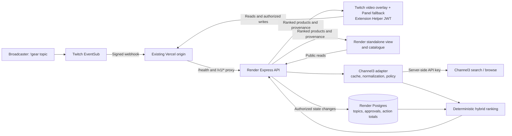

# Architecture

StreamCart connects an explicit broadcaster topic from Twitch chat to Channel3 product discovery. Creator approval and a bounded aggregate-action signal influence the ordering, while each result retains visible provenance.

This document describes the current source. A source change does not establish what is deployed or installed on Twitch; package identities, observations, and remaining release gates belong in the [validation record](validation.md).

## System shape



| Component | Responsibility | Implementation |
| --- | --- | --- |
| Twitch video overlay | Compact, movable capsule that expands to a recommendation card; broadcaster approval and explicit save action | [extension client](../apps/extension/src/main.tsx) |
| Twitch Panel fallback | Same recommendation and creator controls in the fixed Panel placement | [extension client](../apps/extension/src/main.tsx) |
| Standalone preview page | Same recommendation UI, with a movable capsule and expanded card; no Twitch video is behind it | [drag behavior](../apps/extension/src/main.tsx#L65-L92) |
| Catalogue | Collection browse, submitted search, and local brand filters | [catalogue client](../apps/catalogue/src/main.tsx) |
| API | Twitch authority, catalogue boundary, ranking, and state operations | [routes](../apps/api/src/app.ts), [adapter](../apps/api/src/channel3.ts) |
| Store | Common interface over Postgres, private Blob, or a local JSON file | [store implementations](../apps/api/src/store.ts) |

The active Hosted Test surface is a **Video - Fullscreen overlay** in Overlay 1; the Panel path remains a fallback. The capsule can be moved, expanded, and collapsed while the stream remains visible. Both surfaces poll discovery every five seconds and display the first ranked result. There is no video analysis or automatic chat-history ingestion: the broadcaster supplies the topic with `!gear`.

## One creator update, end to end

```mermaid
sequenceDiagram
  participant Creator
  participant Twitch
  participant API as Vercel proxy / Render API
  participant Store as State store
  participant C3 as Channel3 adapter
  participant Overlay as Twitch overlay / Panel fallback
  Creator->>Twitch: !gear streaming microphone
  Twitch->>API: Signed channel.chat.message notification
  API->>API: Verify raw-body HMAC, freshness, message ID
  API->>API: Require chatter = broadcaster and valid command
  API->>Store: Persist channel topic
  API-->>Twitch: 204
  loop Every five seconds
    Overlay->>API: GET channel discovery
    API->>Store: Read topic, approvals, and action totals
    API->>C3: Search topic (cached candidates if fresh)
    C3-->>API: Normalized, policy-filtered products
    API->>API: Rank and suppress / bucket public counts
    API-->>Overlay: Products, provenance, reasons, and bucketed counts
  end
  Creator->>Overlay: Approve this find
  Overlay->>API: POST creator product + Extension JWT
  API->>API: Verify broadcaster role and channel claim
  API->>Store: Add approval for verified channel
  API-->>Overlay: 201; client updates provenance
```

The [webhook route](../apps/api/src/app.ts#L36-L55) changes context; it does not fetch products during webhook acknowledgement. Discovery reads retrieve candidates and combine them with current state. The client updates approval provenance after a successful write, then subsequent polls obtain the server-ranked result.

## Retrieval, collection browse, and safety

All product retrieval crosses one [Channel3 adapter](../apps/api/src/channel3.ts). Frontend builds contain public origins and product UI; Twitch extension surfaces receive their authorization token from Extension Helper. The Channel3 key, Extension signing secret, webhook secret, and database connection string stay server-side. Channel3 calls use the fixed `x-user-id: streamcart-aggregate`, without forwarding a Twitch viewer ID.

| Read path | Candidate request | Local ranking context |
| --- | --- | --- |
| `/v1/channels/:id/discovery` | Channel3 `/v1/search`, stored topic, limit 20 | Stored channel topic |
| `/v1/catalogue/search` | Channel3 `/v1/search`, submitted query, limit 20 | Submitted query |
| `/v1/catalogue/browse` | Channel3 `/v1/browse`, limit 30 | Empty query; no term-relevance contribution |

Both upstream paths include the configured collection ID and availability filters for `InStock` / `LimitedAvailability`. The collection is required in production. Browse exposes one returned collection batch, not an exhaustive paginated inventory. Search requires at least two characters; the catalogue route also caps the query at 120 characters. Brand chips filter the returned batch locally without another API request.

Candidate responses are cached in process for **15 minutes**, keyed by operation, collection, SafeSearch setting, and normalized search text where applicable. Ranking and approval lookup happen after retrieval, so approval changes do not wait for candidate-cache expiry. Upstream requests abort after **7 seconds for search** or **15 seconds for browse**; a live failure is not silently replaced with fixtures.

The adapter normalizes offers, all returned brands, images, and destinations. URLs must be HTTPS, have no embedded credentials or nonstandard port, and match a configured host or its subdomain. Missing required IDs, titles, or valid URLs drop a candidate. Product images and outbound links still contact third-party hosts from the browser.

The [server-side catalogue policy](../apps/api/src/policy.ts) always excludes its weapons patterns. SafeSearch defaults on and adds text-based exclusion patterns over normalized product fields; it is a bounded ruleset, not a comprehensive content classifier. Locale defaults are `US`, `en`, and `USD`, as also selected by [Render configuration](../render.yaml); they remain operator configuration.

## Deterministic hybrid ranking

Channel3 supplies AI-assisted retrieval candidates. StreamCart then applies this [local scoring formula](../apps/api/src/discovery.ts), with no viewer embedding or separately hosted inference model:

```text
R = matching query terms / max(1, number of query terms)
A = 1 when the channel approved the product, otherwise 0
V = 1 when the normalized product is available, otherwise 0
I = min(1, (published view actions + 3 × published save actions) / 25)
score = 0.38R + 0.30A + 0.14V + 0.13Q + 0.05I
```

Query terms are lowercase tokens split on non-word characters. A term matches when it occurs as a substring of the product title, description, or tags. `Q` is the finite provider quality value, defaulting to `0.8`; it is not explicitly clamped. Results sort by descending score.

- Creator approval contributes `0.30`; it does not force a product into first place.
- Save actions carry three times the intent weight of views. The intent contribution saturates at `0.05`, once `views + 3 × saves` reaches 25.
- Ranking uses the same published five-action buckets returned to callers, so suppressed values below five cannot independently change result order. Repeated actions still count as actions, not unique viewers.
- Browse uses an empty query, so `R = 0`. Quality and the final score are not clamped to a unit interval.
- Provenance is `creator_approved` or `ai_discovered`; the reason explains approval, topic matching, or curated collection origin. Approval describes creator choice, not product verification.

## Persisted state and public metrics

The [state schema](../apps/api/src/store.ts#L6-L22) contains three channel-keyed maps:

```text
topics[channelId] = topic
approved[channelId] = [productId, ...]
metrics[channelId][productId] = { view, save }
```

The application persists no viewer ID, viewer profile, per-action history, or chat transcript. It does retain channel identifiers and exact accumulated action totals; Postgres also records when its single state row was updated. Network-address limiter entries are transient, and infrastructure, Twitch, Channel3, and retailer telemetry are outside this application-state claim.

For each public metric, the [publication rule](../apps/api/src/discovery.ts#L4-L15) is:

```text
published(n) = 0,                 when n < 5
published(n) = floor(n / 5) × 5,  otherwise
```

Thus `0` means zero or suppressed activity; `10` is a lower bound, not an exact total or ten distinct people. The intent-write response returns `recorded` and a visibility boolean instead of the exact post-write count. The numeric score is removed from public results, and ranking uses only the same published buckets, so counts below five cannot affect ordering. These measures do not establish anonymity, differential privacy, or distinct-viewer verification. The deployed API must be updated before this behavior applies publicly.

Store selection is `DATABASE_URL` → Postgres, otherwise Blob configuration → private Blob, otherwise local JSON:

| Adapter | Mutation behavior | Limit |
| --- | --- | --- |
| Postgres | Transaction locks the single JSONB state row with `FOR UPDATE`; pool maximum four connections | All channel writes serialize on one row |
| Private Blob | Conditional ETag replacement; at most five attempts on write conflict | Whole-document reads/writes and provider quota |
| Local file | Mode-0600 temporary file followed by rename | Synchronous whole-file writes; no multi-process lock |

Metrics allow at most **1,000 channel namespaces** and **500 products per channel**. Topics and approval arrays have no equivalent cardinality cap. There is no aggregate retention expiry or metric-deletion workflow; removing creator approval changes provenance, not historical counters. See [storage and adapter selection](../apps/api/src/store.ts#L24-L172).

## Authority and webhook boundaries

| Operation | Required authority in live mode |
| --- | --- |
| Discovery / catalogue reads | Public; channel selection affects the returned context and approvals |
| Approve / remove approval | Verified HS256 Extension JWT, `broadcaster` role, nonempty signed `channel_id`; that claim selects the mutated channel |
| Record view / save | Verified `viewer` or `broadcaster` JWT; body channel must match; product must occur in current topic discovery |
| Set topic from chat | Valid Twitch webhook signature and broadcaster-authored matching chat command |
| Demo trigger | Available only with explicit demo mode; production startup rejects demo mode |

The [authorization middleware](../apps/api/src/security.ts#L9-L31) verifies the JWT server-side. Client-side role decoding only controls presentation. Creator approval accepts a bounded product ID but does not perform the intent route's current-result membership check. Public standalone pages cannot grant themselves creator authority through URL parameters.

[CORS](../apps/api/src/app.ts#L34-L35) grants browser read permission to exact configured origins and allows requests without an Origin header. It does not authenticate requests or prevent direct clients. Production [configuration checks](../apps/api/src/config.ts#L30-L42) require credentials, collection configuration, and nonempty allowlists; they do not independently require SafeSearch to remain enabled.

The [EventSub verifier](../apps/api/src/security.ts#L33-L40) computes HMAC-SHA256 over message ID + timestamp + the raw body, checks equal signature lengths with a timing-safe comparison, and requires an absolute timestamp difference under ten minutes. The raw 64 KiB JSON route runs before generic JSON parsing.

Implemented handling returns the challenge from a verified request and accepts `channel.chat.message` notifications only when chatter and broadcaster IDs match. `!gear` captures a 2–80-character topic. A process-local replay map retains message IDs for ten minutes, capped at 10,000 entries.

Missing lifecycle pieces are explicit: no durable delivery queue, shared replay store, persisted expected subscription-ID/condition check, automated revocation recovery, or Channel3 product-update webhook receiver. Replay IDs are remembered before parsing/storage completes, so a downstream failure can suppress a retried delivery. Subscription registration/migration is an [operator workflow](../scripts/register-eventsub.mjs), not automatic runtime recovery.

## Deployment and operational limits

The [Render Blueprint](../render.yaml) declares a static frontend, Docker API, and Postgres database, with automatic deployment disabled. The [static build](../scripts/build-vercel.mjs) exports extension, catalogue, and credential-free proof pages. Public Vite origins are embedded at build time; server credentials stay in API runtime configuration.

| Deployed responsibility | Public address / implementation |
| --- | --- |
| Standalone application and catalogue | `https://streamcart-twitchcon-site-20261102.onrender.com` |
| Express API and current state adapter | `https://streamcart-twitchcon-api.onrender.com`, Render Postgres |
| Existing Twitch-compatible origin | `https://streamcart-twitchcon.vercel.app`; `/health` and `/v1/*` [rewrite to Render](../vercel.json) |
| Installed Twitch extension assets | Twitch-hosted ZIP; Video Overlay 1 active and Panel path retained as fallback; independent from static-site/API deployments |

The Render static build calls the Render API directly. Existing Twitch packages and the EventSub callback retain the Vercel origin through its proxy. Changing browser/API origins can require matching CORS and Twitch capability allowlists; updating source or the standalone site does not update an uploaded Twitch ZIP.

The [Dockerfile](../Dockerfile) uses a build stage, pruned production dependencies, and a non-root `node` runtime. The [Docker context exclusions](../.dockerignore) omit environment files, local data, logs, and generated artifacts.

Current operating bounds follow directly from the implementation:

- `/health` reports configuration (`ok`, mode, SafeSearch), not database, Channel3, EventSub, or Twitch broadcast readiness. The [ten-minute scheduled request](../.github/workflows/keep-render-warm.yml) is an availability aid, not an uptime guarantee.
- Free hosting can cold-start; database lifetime and provider quotas need operator monitoring. Deployment-specific observations belong in [validation](validation.md).
- Candidate caches, replay IDs, and rate limits are process-local. The cache has no maximum key count or general eviction pass; multiple replicas do not share it.
- Intent writes are limited to 30 requests per minute per observed network address, with at most 10,000 limiter entries. Proxy topology affects address granularity; there is no distributed limiter or unique-person deduplication.
- Live catalogue reads can consume upstream requests on cache misses. There is no general read-route rate limit, background inventory synchronization, or durable event retry worker.
- Postgres protects state mutations with a transaction, but the single-document model, uncapped topic/approval growth, and absence of retention are scaling constraints rather than production guarantees.
